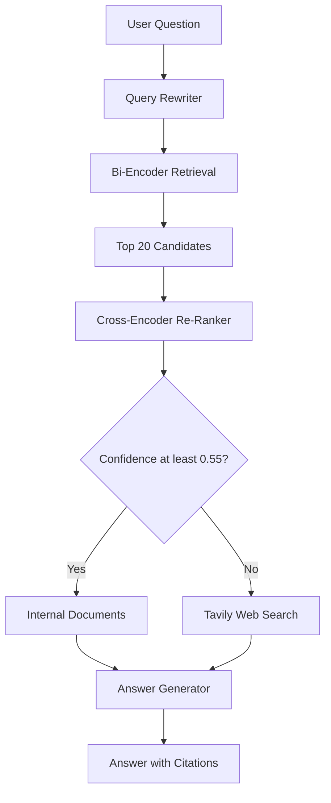

# Production RAG Pipeline

## Week 6 AI Engineering Assignment

This project is a two-stage Retrieval-Augmented Generation
(RAG) application built with Python and Streamlit.

It retrieves information from internal documents and
automatically searches the web when internal retrieval
confidence is low.

## Technologies Used

- Python 3.11
- Streamlit
- ChromaDB
- Sentence Transformers
- OpenAI
- Tavily Search API
- Pydantic
- Pytest

## System Architecture



## How the Application Works

1. The user enters a question.
2. The query rewriter improves the question.
3. ChromaDB retrieves up to 20 document chunks.
4. The cross-encoder reranks the results.
5. The system calculates a normalized relevance score.
6. If the score is at least 0.55, internal documents are used.
7. Otherwise, Tavily performs a web search.
8. OpenAI generates an answer with citations.

## Installation

Clone the repository and open the project folder.

Install dependencies:

```bash
uv sync
```

## Environment Variables

Create a `.env` file containing:

```dotenv
OPENAI_API_KEY=your_openai_key
TAVILY_API_KEY=your_tavily_key
```

Never commit your actual API keys to GitHub.

## Run the Application

```bash
uv run python -m streamlit run src/app.py
```

Open http://localhost:8501 in your browser.

## Run Automated Tests

```bash
uv run python -m pytest -v
```

Initial test results:

8 tests passed.

## Confidence Threshold

The initial threshold is 0.55.

Cross-encoder logits are normalized using the sigmoid
function.

A score above the threshold selects INTERNAL_RAG.
A score below the threshold selects WEB_FALLBACK.

The threshold is preliminary and requires further
calibration across additional test queries.

## Testing Results

Internal question:
"What should I do if deployment fails?"

Result: INTERNAL_RAG with document citations.

External question:
"What is the latest SpaceX Starship launch news?"

Result: WEB_FALLBACK with external source links.

## AI Code Audit

AI-assisted development findings and testing notes
are documented in ai_prompt_log.md.

## Current Limitations

- Only two short internal documents are currently indexed.
- Confidence threshold calibration is incomplete.
- Additional end-to-end security testing is needed.
- The current prompt-injection test uses a mocked response.

## Project Purpose

This assignment demonstrates query transformation,
two-stage retrieval, confidence-based routing,
web fallback, answer generation, and automated testing.
